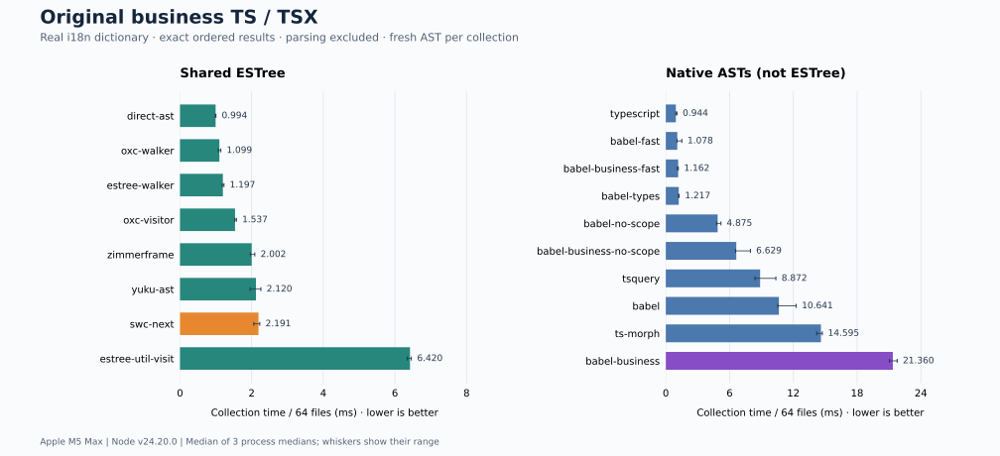
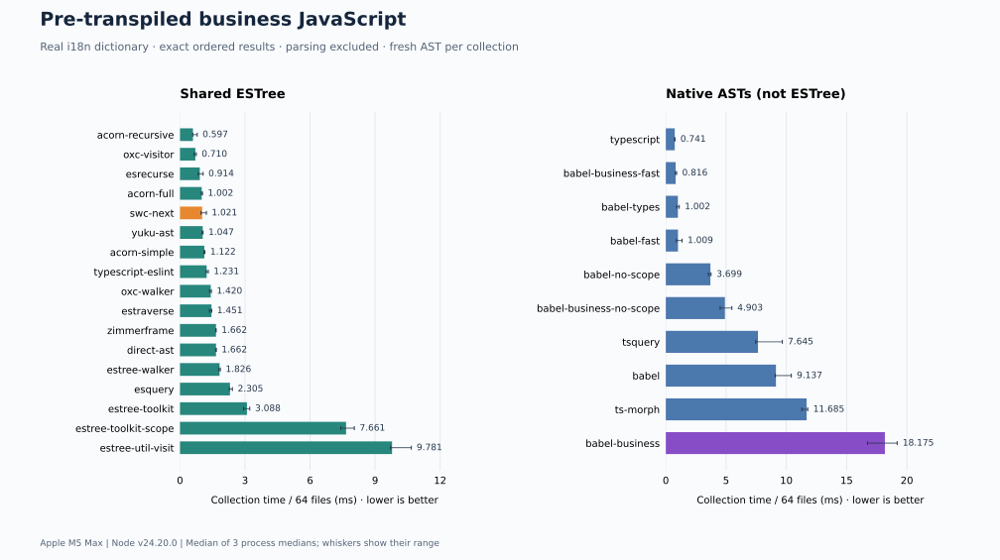

# Read-only AST visitor benchmark

Collect real i18n keys from **64 business modules** using **30 JavaScript traversal variants**. Based on the application's actual Rspack loader; no source edits or code generation inside the benchmark.

[Full results & compatibility](docs/i18n/results.md) · [Corpus manifest](docs/i18n/corpus.json) · [Collector implementations](src/i18n/plugins) · [Styled-components benchmark](docs/styled-components.md)

## The task

```js
const usedKeys = [];
traverse(ast, {
  StringLiteral(path) {
    if (allKeysSet.has(path.node.value)) usedKeys.push(path.node.value);
  },
});
```

All string literal positions count, including nested code, imports and object keys. Preserve order and duplicates. This requires neither scope analysis nor AST editing.

## Results

**direct-ast leads the shared-ESTree original-source group at 0.994 ms / 64 files.** AST families are ranked separately: a native-AST result measures its tree layout as well as its traversal API.

For the existing Babel loader, the smallest measured changes are **`noScope: true` (3.2×)** or **`@babel/types.traverseFast` (18.4×)**, relative to its installed Babel 7.27.3 traverse. These are collection-stage speedups, not loader/build speedups.

| Original TS/TSX | AST | Collection, ms |
| :-- | :-- | --: |
| direct-ast | ESTree | 0.994 |
| oxc-walker | ESTree | 1.099 |
| swc-next | ESTree | 2.191 |
| yuku-ast | ESTree | 2.120 |
| babel-business | Babel 7 AST (not ESTree) | 21.360 |
| babel-business-no-scope | Babel 7 AST (not ESTree) | 6.629 |
| babel-business-fast | Babel 7 AST (not ESTree) | 1.162 |



The compatibility track uses the **same modules pre-transpiled to ES2022 JavaScript**. It expands coverage to JS-only walkers. Transpilation happens before measurement and changes the strings available to collect; **do not compare timings between tracks**.



## Corpus & measurement

- **231.2 KiB** of original source: 40 TS + 24 TSX files, deterministically sampled from four application layers, without selecting by match count. 11 files contain matches.
- **18,868 dictionary keys**, from the actual domestic configuration (`zh` + `zh-Hant`). Original source: **59 matches**; JavaScript: **58 matches**. No synthetic i18n strings are injected.
- ESTree participants receive structurally identical inputs: Oxc TS-ESTree for original source, Acorn ESTree for JavaScript. Babel, SWC and TypeScript participants prepare their own ASTs, explicitly labeled **not ESTree**.
- **3 isolated processes × 5 warmups + 12 measured iterations**, per variant and track; rotated process order. Each iteration collects all 64 files. Bars are medians of process medians, with min–max whiskers.
- Fresh parsing/AST preparation occurs **outside each timed collection** to avoid warm NodePath/scope caches. Hook construction, scope analysis when enabled, traversal, `Set.has` and result allocation are timed. GC during collection is included.
- Ordered arrays are checked against the Babel oracle per file, every iteration. The oracle was also checked against the business repository's installed Babel 7.27.3. Unsupported or mismatching implementations are excluded, not assigned zero time.
- Corpus parity is not universal Babel compatibility. In particular, ESTree `Literal` includes directive strings, while Babel `StringLiteral` excludes directives. The actual dictionary/corpus passes; adapting arbitrary future inputs needs a separate semantic audit.

SWC Next is pinned to the latest committed PR branch snapshot **[a20f5fa](https://github.com/swc-project/swc-next/commit/a20f5fa4755e52e9760d51c41a1f7a02ba3e3316)**. No before/after variants. `direct-ast` recursively inspects AST properties itself, with no package visitor or visitor-key table; it does not assume top-level declarations. The removed `handwritten` case is not restored.

## Reproduce

Requires Node 24+, the local business checkout (source + locale files), and its installed Babel dependencies. Private source and dictionary values remain in ignored `.cache/i18n/`; only paths, hashes and aggregate results are tracked.

```sh
npm ci
export FLOW_WEB_ROOT=/absolute/path/to/flow-web-monorepo
npm run i18n:prepare
npm test
npm run i18n:validate
npm run i18n:bench
python3 -m venv .cache/charts-venv
.cache/charts-venv/bin/pip install -r scripts/requirements-charts.txt
PYTHON=.cache/charts-venv/bin/python npm run i18n:report
```

`i18n:bench` refreshes SWC Next from PR #840 via `gh`. For the committed snapshot, run `node scripts/i18n/bench.mjs` directly. `i18n:prepare` intentionally resamples the current checkout; compare its manifest hashes before treating reruns as the same corpus.

Measured on **Apple M5 Max · darwin arm64 · Node v24.20.0**. The sample contains original repository source, not captured loader inputs or a full Rspack build. [Raw samples](results/i18n/latest.json) include preparation time, heap, process RSS and peak RSS.
