# JavaScript AST traversal benchmarks

**Four workloads. CPU instruction counts (Ir), simulated throughput cycles (Ct), and a paired wall-time control.**

v24.20.0 · linux/arm64 · 8-vCPU VM · codspeed-runner 5.2.1 · 2026-10-14

207 supported combinations; 15 explicit compatibility failures. Each has 3 isolated CPU runs and 3 normal-JIT wall-time runs. Private i18n source stays local.

## Do the rankings agree?

Same-ESTree comparisons only. Spearman ρ = 1 means identical ordering; 0 means no monotonic relationship. Near-ties can swap ranks.

| Scenario / track | Ir ↔ wall ρ | Ct ↔ wall ρ | Ir winner | Ct winner | Wall winner |
| :-- | --: | --: | :-- | :-- | :-- |
| styled-components / dense | 0.953 | 0.961 | direct-ast | direct-ast | direct-ast |
| styled-components / sparse | 0.953 | 0.946 | direct-ast | direct-ast | direct-ast |
| remove-debugger / dense | 0.925 | 0.930 | acorn-recursive | acorn-recursive | oxc-visitor |
| remove-debugger / sparse | 0.956 | 0.953 | acorn-recursive | acorn-recursive | oxc-visitor |
| rstest-coverage / runtime | 0.942 | 0.947 | acorn-recursive | acorn-recursive | oxc-visitor |
| rstest-coverage / tooling | 0.935 | 0.937 | acorn-recursive | acorn-recursive | oxc-visitor |
| i18n / original | 0.476 | 0.429 | direct-ast | direct-ast | oxc-visitor |
| i18n / javascript | 0.902 | 0.904 | acorn-recursive | acorn-recursive | oxc-visitor |

Across these tracks, Ir ↔ wall ρ ranges from **0.476–0.956**, and Ct ↔ wall from **0.429–0.961**. Excluding the manual direct-ast baseline, Ct and wall select the same fastest library in **0/8** tracks. High overall correlation can hide changes among the fastest libraries:

| Scenario / track | Lowest Ct library | Fastest wall-time library | Top-five overlap |
| :-- | :-- | :-- | --: |
| styled-components / dense | acorn-recursive | oxc-visitor | 4/5 |
| styled-components / sparse | acorn-recursive | oxc-visitor | 4/5 |
| remove-debugger / dense | acorn-recursive | oxc-visitor | 4/5 |
| remove-debugger / sparse | acorn-recursive | oxc-visitor | 4/5 |
| rstest-coverage / runtime | acorn-recursive | oxc-visitor | 4/5 |
| rstest-coverage / tooling | acorn-recursive | oxc-visitor | 4/5 |
| i18n / original | estree-walker | oxc-visitor | 4/5 |
| i18n / javascript | acorn-recursive | oxc-visitor | 4/5 |

Process min–max spread, as a percentage of the median (median across all supported combinations / worst combination): **Ir 0.00074% / 0.084%; Ct 0.00080% / 0.072%; wall 6.337% / 35.727%.** These are observed ranges, not confidence intervals.

**Simulation is a different execution mode.** CodSpeed disables TurboFan; this suite also disables Maglev, following [SWC Next #747](https://github.com/swc-project/swc-next/pull/747). Ir counts executed instructions; On ARM64, Ct uses a [Cortex-A72 cost table](https://github.com/CodSpeedHQ/valgrind-codspeed/blob/3.26.0-0codspeed7/callgrind/arm64_caps_lut.inc) and [cache-independent accumulation](https://github.com/CodSpeedHQ/valgrind-codspeed/blob/3.26.0-0codspeed7/callgrind/bbcc.c#L615); it is not a hardware-cycle counter for this host. Neither is a measurement of normal-JIT elapsed time. Use these counters for reproducible cost comparisons, and retain wall time to evaluate real runtime performance.

A targeted two-flag control changes the ordering: disabling optimizing JIT slows oxc-visitor by **5.44×** in styled-components/dense and **4.87×** in original-source i18n. This establishes an execution-mode effect in those controls; it does not isolate individual V8 optimizations or explain every Ct difference. [Control and raw samples](docs/cpu/jit-control.md).

[Targeted JIT control](docs/cpu/jit-control.md) · [All numbers and per-family ranks](docs/cpu/results.md) · [Method and reproduction](docs/cpu/README.md) · [Raw measurements](results/cpu/latest.json) · [Comparison with the previous wall-time ranking](docs/cpu/historical-ranks.md)

## Styled-components

[Workload and editing strategy](docs/styled-components/README.md). Bars show Ir (K) and Ct (K), lower is better; rows share the Ct ordering.

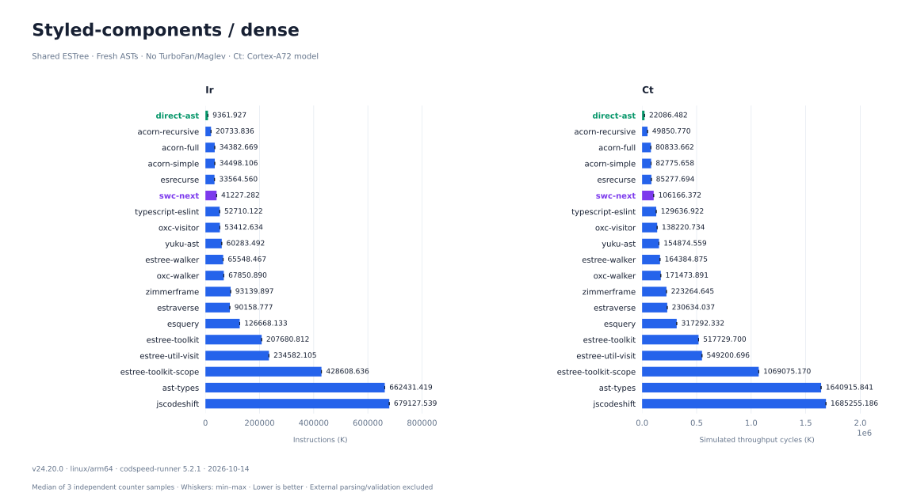

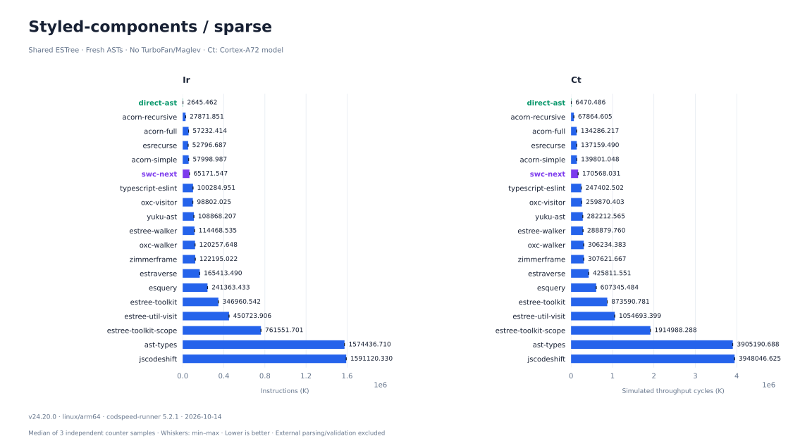

Native ASTs — not an ESTree comparison

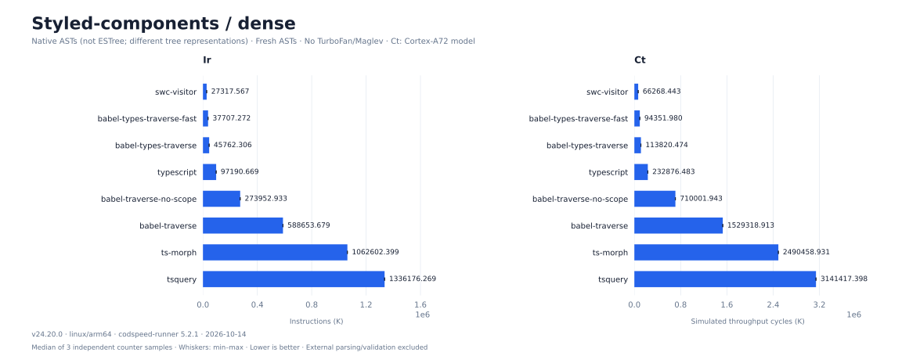

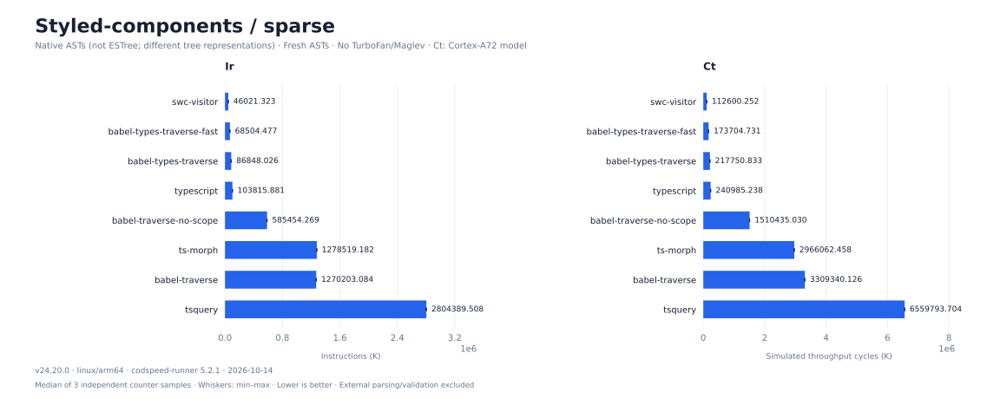

## Remove debugger

[Workload and editing strategy](docs/remove-debugger/README.md). Bars show Ir (K) and Ct (K), lower is better; rows share the Ct ordering.

Native ASTs — not an ESTree comparison

## Normalize coverage branches

[Workload and editing strategy](docs/rstest-coverage/README.md). Bars show Ir (K) and Ct (K), lower is better; rows share the Ct ordering.

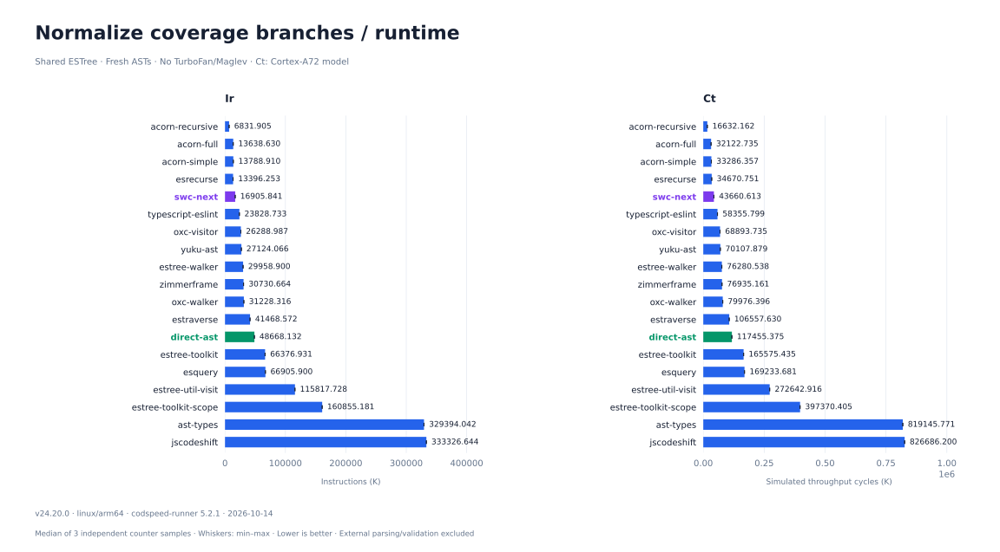

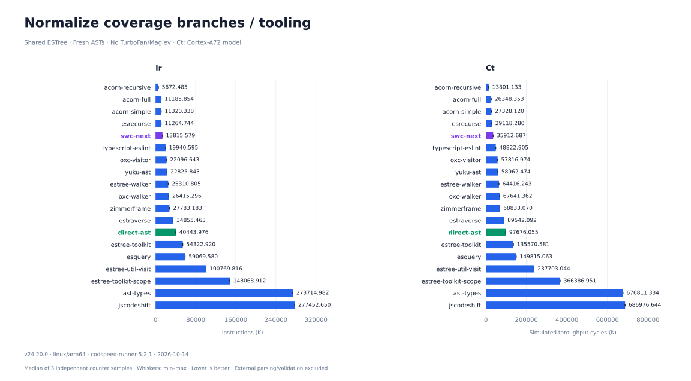

Native ASTs — not an ESTree comparison

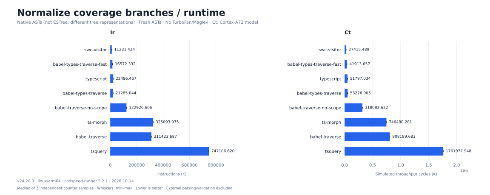

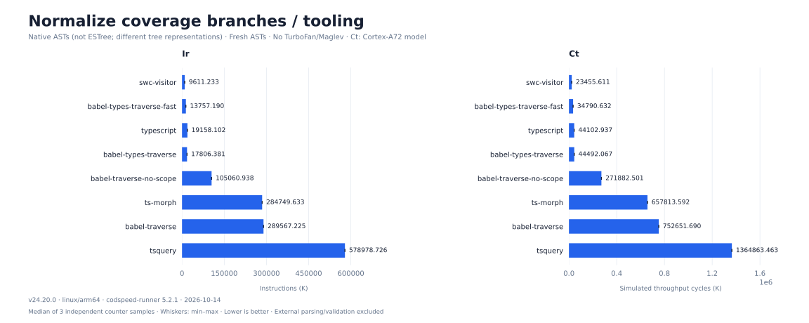

## Collect i18n strings

[Workload and editing strategy](docs/i18n/README.md). Bars show Ir (K) and Ct (K), lower is better; rows share the Ct ordering.

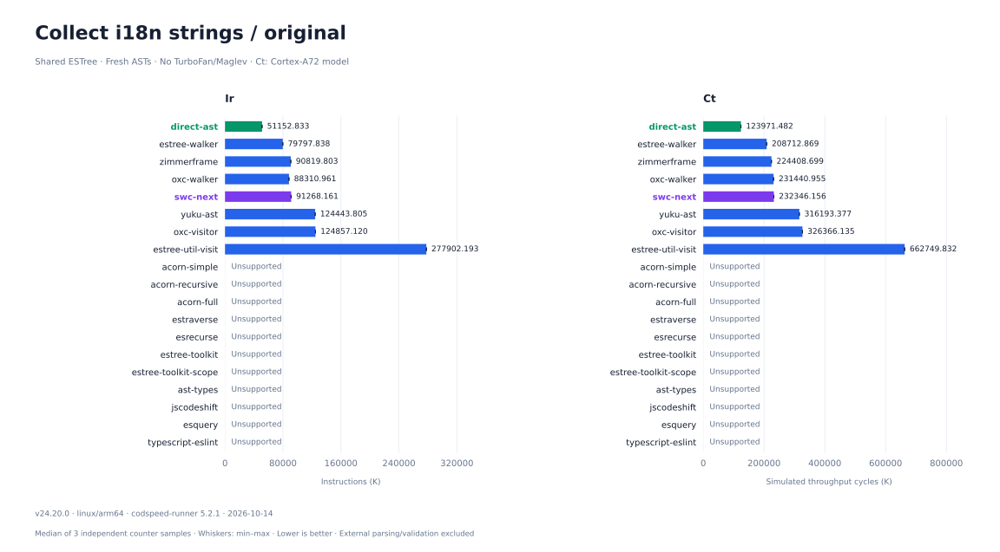

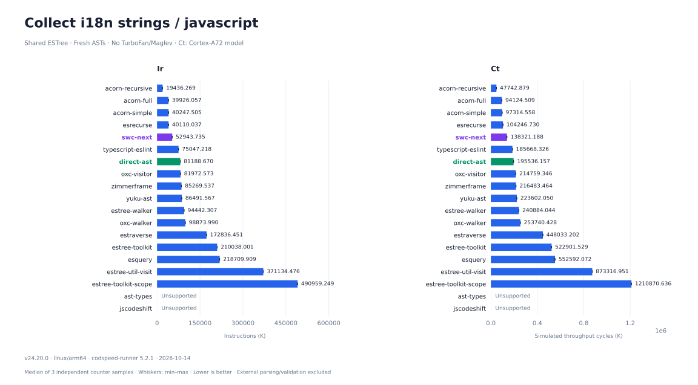

Native ASTs — not an ESTree comparison

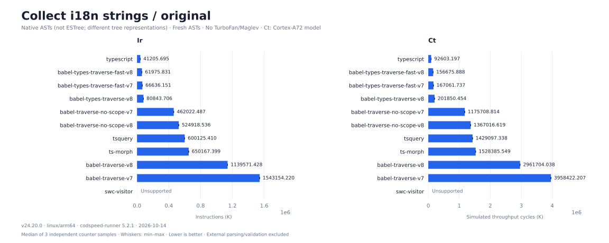

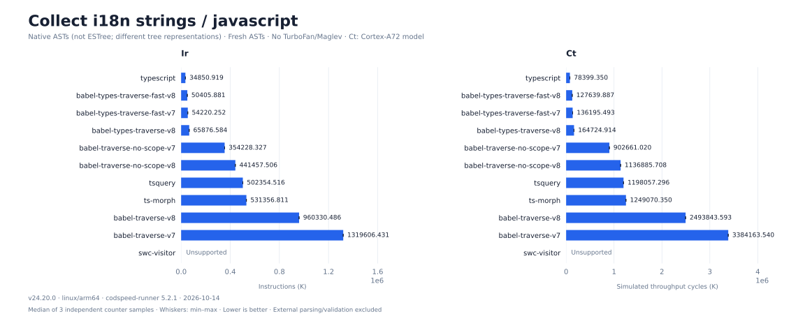

Presentation inspired by [Native ECMAScript Parser Benchmark](https://github.com/yuku-toolchain/ecmascript-parser-benchmark-native).
