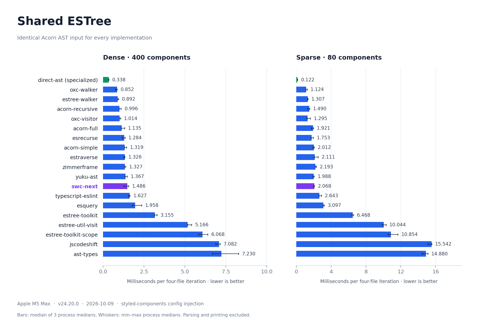
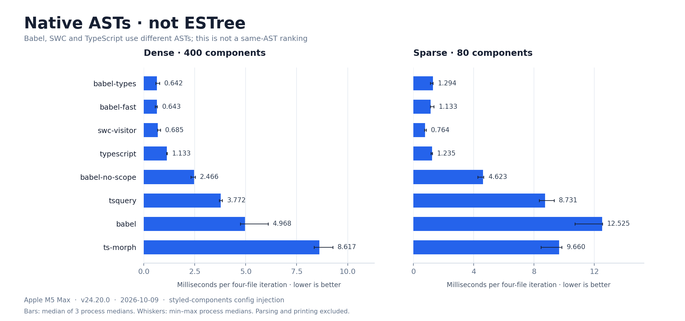

# JavaScript Visitor Benchmark

Compare 27 JavaScript AST traversal and editing implementations using a styled-components `displayName` / `componentId` transform.

## System

| Property | Value |
| --- | --- |
| CPU | Apple M5 Max |
| OS | darwin (arm64) |
| Runtime | Node.js v24.20.0 |
| Memory | 64 GiB |
| Measured | 2026-10-09 |

## Benchmarks

### Shared ESTree

Every implementation receives an independent clone of the **same Acorn AST**. Dense: 400 components; sparse: 80 components with more unrelated code. Both workloads contain four files.

`direct-ast` edits top-level declarations without a visitor API. It skips unrelated subtrees by design.



### Native ASTs

Babel, SWC and TypeScript prepare their own ASTs from the same source. **These inputs are not ESTree**; do not treat this chart as a same-AST comparison. Scope-enabled and wrapper APIs include their additional work.



[Full results and memory](results/latest.md) · [Raw samples](results/latest.json) · [Implementations](src/registry.mjs)

## Run

Node.js 24+ and GitHub CLI (`gh`) for refreshing the SWC Next branch snapshot:

```sh
npm ci
npm test
npm run bench
```

Regenerate the charts and this README (Python 3 + Matplotlib):

```sh
python3 -m pip install -r scripts/requirements-charts.txt
npm run report
```

Use `npm run bench:quick` for a smoke run, or `npm run bench -- --only=swc-next,yuku-ast,oxc-walker --output=focused` for selected implementations. Set `PYTHON` to use a virtual environment for chart generation.

## Methodology

Each implementation runs in 3 fresh processes with 8 warmups and 20 measured iterations per process. Timing covers visitor setup, traversal and edits; parsing, cloning, printing and output validation are excluded. Every measured output is checked against an independent expected result.

This is a focused config-injection workload, **not the complete styled-components plugin**. See [methodology and coverage](docs/methodology.md) for semantics, exclusions and memory definitions.

SWC Next is pinned to [`a20f5fa`](https://github.com/swc-project/swc-next/commit/a20f5fa4755e52e9760d51c41a1f7a02ba3e3316) on `codex/js-ast-hooks`. The default `npm run bench` refreshes this snapshot automatically. Use `npm run bench:pinned` to explicitly reuse it offline.

Presentation inspired by [Native ECMAScript Parser Benchmark](https://github.com/yuku-toolchain/ecmascript-parser-benchmark-native).
