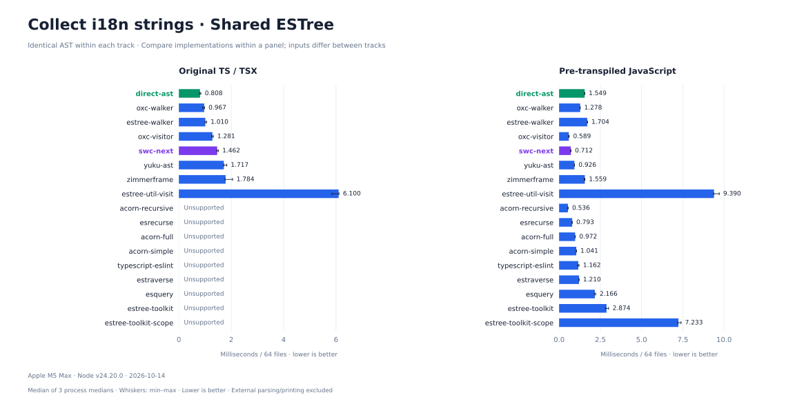
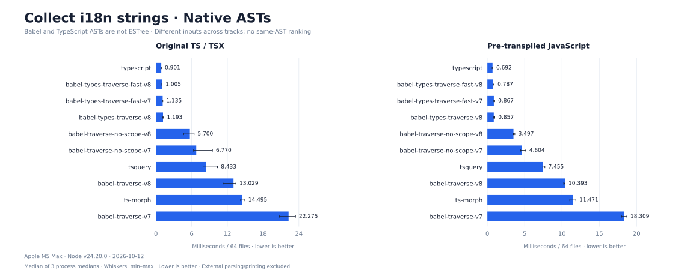

# JavaScript AST traversal benchmarks

**Three concrete tasks. Same AST within each ESTree track. Validated output on every measured iteration.**

| Scenario | Work | Corpus | Results |
| :-- | :-- | :-- | :-- |
| Styled-components | Inject displayName / componentId | Generated JS; dense + sparse | [Details](docs/styled-components/README.md) |
| Remove debugger | Delete list elements; replace single statement slots | Generated JS; dense + sparse | [Details](docs/remove-debugger/README.md) |
| Collect i18n strings | Read literals, check dictionary, preserve order and duplicates | 64 real TS/TSX modules + pre-transpiled JS | [Details](docs/i18n/README.md) |

Lower is better. Bars show medians of process medians; whiskers show their min–max range, **not confidence intervals**. Compare implementations within a track; do not compare absolute times across scenarios or AST families. Scope analysis, query setup and wrapper work are included where the API performs them.

## 1. Styled-components

A focused config-injection transform, **not the complete official plugin**. Dense: 400 edits; sparse: 80 edits across more unrelated code. The direct-ast baseline exploits top-level declarations and skips unrelated subtrees.


Native Babel, SWC and TypeScript ASTs are **not ESTree**; these results are not a same-AST walker ranking.


[All numbers and strategies](results/styled-components/latest.md)

## 2. Remove debugger

Removes consecutive and nested debugger statements. Single statement slots (for example `if (flag) debugger;`) become empty statements to preserve control flow. APIs without built-in removal use explicit manual edits, **included in the timer**. See the [strategy table](results/remove-debugger/latest.md#implementations).


Native Babel, SWC and TypeScript ASTs are **not ESTree**; these results are not a same-AST walker ranking.


[All numbers and strategies](results/remove-debugger/latest.md)

## 3. Collect i18n strings

The application's Babel StringLiteral collector, using 18,868 real dictionary keys. No source edits. Original source: 59 matches; pre-transpiled JavaScript: 58 matches. Private source stays outside Git.

Each chart uses the same layout as the editing scenarios: one AST family per image, with original TS/TSX on the left and pre-transpiled JavaScript on the right. Rows align across columns; unsupported combinations have no timing bar.



Native Babel and TypeScript ASTs are **not ESTree**; these results are not a same-AST walker ranking.



[Compatibility failures and all results](docs/i18n/results.md) · [Corpus provenance](docs/i18n/corpus.json) · [Historical Acorn/Yuku profiling study](docs/i18n-dispatch/README.md) · [Oxc performance attribution](docs/oxc-attribution/README.md)

The JavaScript compatibility track transforms the same modules before timing so JS-only walkers can participate. It is not captured loader input and must not be compared directly with the original TS/TSX track. Acorn's static destructuring-key collection is covered by a regression fixture.

## Measurement

- **ESTree:** identical Acorn AST clones for editing; Oxc TS-ESTree for original i18n and Acorn ESTree for its JavaScript track. Fresh AST preparation is outside every timed transform/collection.
- **Native ASTs:** Babel, SWC and TypeScript parse the same source into their own representations, explicitly labeled **not ESTree**. These rows measure both tree layout and API costs.
- **Correctness:** editing results are printed/reparsed and compared against independent expected source; i18n results are exact ordered arrays checked against Babel. Unsupported implementations are reported, not assigned a zero time.
- **Timing:** isolated processes, sequential execution with rotated/reversed order. Edits: 3 processes × 8 warmups + 20 samples; i18n: 3 × 5 + 12. Preparation, external printing and checks are excluded; internal ts-morph text updates are included.
- **Evidence:** [styled raw data](results/styled-components/latest.json), [debugger raw data](results/remove-debugger/latest.json), [i18n raw data](results/i18n/latest.json) retain samples, source hashes, versions and whole-worker memory. Results are corpus-specific, not a universal performance ceiling.

Apple M5 Max · darwin/arm64 · Node v24.20.0. Measured: styled 2026-10-12, debugger 2026-10-12, i18n 2026-10-12. SWC Next uses the committed PR snapshot recorded in each result; no before/after variants.

## Run

Node 24+; Python + Matplotlib for charts. The real i18n corpus additionally needs the business checkout and its installed Babel 7 dependencies.

```sh
npm ci
npm test
# Synthetic scenarios are self-contained:
npm run bench -- styled-components
npm run bench -- remove-debugger

# Private business corpus:
export FLOW_WEB_ROOT=/absolute/path/to/flow-web-monorepo
npm run i18n:prepare
npm run bench -- i18n

# All three, sequentially (requires the prepared business corpus):
npm run bench

python3 -m venv .cache/charts-venv
.cache/charts-venv/bin/pip install -r scripts/requirements-charts.txt
PYTHON=.cache/charts-venv/bin/python npm run report
```

`--quick` writes smoke results separately. Runs use the committed SWC Next snapshot; `npm run sync:swc` explicitly refreshes PR #840 via GitHub CLI. Rerun tests and all benchmarks after refreshing. `i18n:prepare` resamples the current checkout: check corpus hashes before comparing reruns.

## Layout & extension

```text
src/
  scenarios.mjs          # Scenario catalog
  shared/                # AST oracle, implementation identities, Babel I/O
  styled-components/     # Workload, registry, plugins
  remove-debugger/       # Workload, registry, plugins
  i18n/                  # Corpus, registry, collectors
scripts/
  bench.mjs              # One entry point; sequential scenario execution
  render.mjs             # Generate all reports and this README
  shared/                # Mutation runner, measurement provenance, charts
  styled-components/     # Input AST sample generation
  i18n/                  # Business corpus preparation and read-only runner
results/<scenario>/      # Raw samples and summaries
charts/<scenario>/       # Generated SVG/PNG charts
docs/<scenario>/         # Contracts, methodology and interpretation
experiments/             # Separate profiling/ablation studies
vendor/                  # Pinned SWC Next source and provenance
```

To add an editing scenario, implement `workload.mjs` (source + independently expected output), `registry.mjs` and `execute.mjs` (prepare/run/validate), add package-specific modules under `plugins/`, then register it in `src/scenarios.mjs`. [Extension guide](docs/extending.md) covers runners, validation and reports.

Presentation inspired by [Native ECMAScript Parser Benchmark](https://github.com/yuku-toolchain/ecmascript-parser-benchmark-native).
