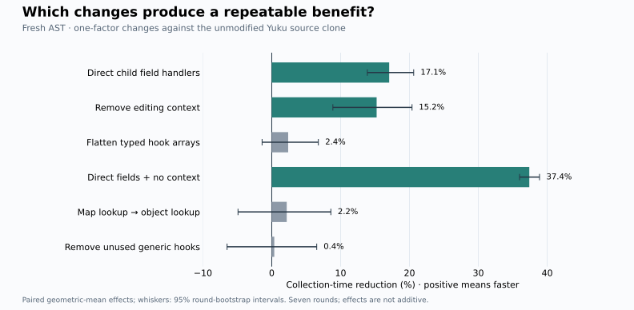
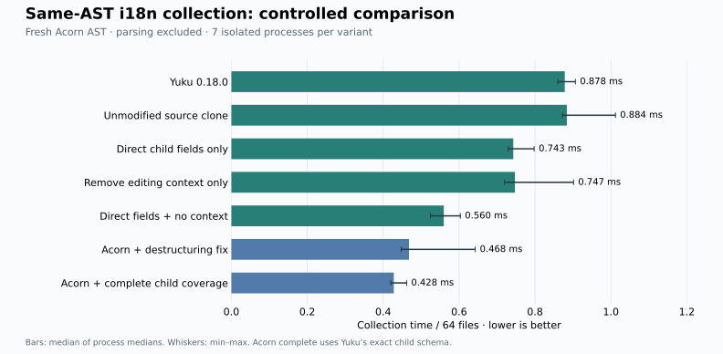

# Acorn vs Yuku: measured causes

**Direct child-field specialization and editing-context bookkeeping explain substantial costs in this workload. Flattening typed hooks alone does not show a repeatable benefit.** This is a controlled study of `acorn-walk@8.3.5` and `yuku-ast@0.18.0`, not a general ranking of visitor API designs.

[Raw timings](../../results/i18n-dispatch/latest.json) · [Hook controls](../../results/i18n-dispatch/hook-controls.json) · [Experiment source](../../experiments/i18n-dispatch) · [Correctness evidence](../../results/i18n-dispatch/validation.json)

## Findings

| Change from the Yuku source clone | Fresh AST time reduction | Reused AST time reduction | Finding |
| :-- | --: | --: | :-- |
| Direct child access only | 17.1% [13.9, 20.6] | 21.6% [20.3, 22.9] | Repeatable benefit |
| Remove context only | 15.2% [8.9, 20.4] | 16.1% [12.7, 18.9] | Repeatable benefit |
| Flatten typed hook arrays only | 2.4% [-1.4, 6.8] | 1.1% [-1.0, 2.6] | Interval crosses zero |
| Direct access + remove context | 37.4% [36.0, 38.9] | 48.2% [47.5, 49.2] | Combined benefit; retains typed hook arrays |
| Map lookup to object lookup only | 2.2% [-4.9, 8.6] | -0.9% [-5.1, 4.0] | Interval crosses zero |
| Remove unused global hooks only | 0.4% [-6.5, 6.5] | -0.8% [-5.4, 3.3] | Interval crosses zero |

Percentages are geometric means of paired process-median ratios, with descriptive 95% bootstrap intervals over seven rounds. They are not percentages computed from the separately reported median bars, and **must not be added**. The fresh and reused modes show the same qualitative findings.



## What each experiment changes

1. **Child access:** replace `CHILD_KEYS[node.type]` iteration and `node[key]` reads with generated per-type child functions using named field accesses. Preserve child coverage, order, null/object/array guards and context semantics. This measures field specialization plus the changed function/inline-cache structure; it does not isolate dot syntax alone.
2. **Editing context:** remove current-position writes, ancestor push/pop, array cursor-frame objects and stop/skip/replace/remove checks together. Keep child coverage and typed enter/leave arrays. This is deliberately a read-only specialization, not a drop-in replacement for the mutable API. It does not establish the individual cost of each bookkeeping component.
3. **Typed hooks:** replace enter/leave arrays with single handler slots, keeping `Map` lookup, child traversal and editing semantics. Separate follow-up controls replace `Map` with a null-prototype object, or remove the unused global enter/leave checks. None of these individual changes produced a stable positive effect. This does not prove the entire hook protocol is free; interactions and other dispatch differences remain.

The eight variants cover every combination of direct/key-based children, array/single hooks and context/read-only traversal. Source generation uses local installed Yuku code; the unmodified clone is the control. Its fresh-AST difference from the package was small (the bootstrap interval includes zero). Measured source hashes are stored with the samples.

## Same work, different traversal coverage

The 64 real JavaScript modules contain **1,247 string-literal occurrences**, of which **58** match the actual i18n dictionary. All timed variants match the exact ordered i18n output; all also match the full ordered string-literal output on this corpus. AST JSON remains unchanged.

The historical Acorn case fails a separate static-string destructuring fixture. The experimental `acorn-fixed` case fixes it. `acorn-full-coverage` goes further: it uses Yuku's exact child schema, with every node occurrence and traversal order checked against Yuku. It still uses Acorn's native `recursive()` handler-override API. These are experimental cases; historical overview timings have not been silently replaced.

| Structural work / 64 modules | Yuku | Acorn fixed | Acorn complete coverage |
| :-- | --: | --: | --: |
| Distinct node objects reached | 19,482 | 16,148 | 19,482 |
| Node visits / dispatch calls* | 19,769 | 29,035 | 19,769 |
| Acorn pseudo-type dispatches | N/A | 13,979 | 0 |

*These are explicitly different counters: Yuku node visits versus Acorn dispatch calls. Acorn dispatches through pseudo-types such as `Expression`, `Statement` and `Pattern`, so it makes more dispatch calls even while reaching fewer distinct nodes. Shared AST objects can be visited more than once. See the [coverage audit](../../results/i18n-dispatch/coverage-audit.json).

Yuku's unmodified source executes 35,961 child-field checks, two position updates per node visit, 17,825 ancestor push/pop pairs and 4,028 array cursor-frame constructions per corpus. There is one reused `WalkContext` per file, not one per node. These are logical source-level operations, not measured heap allocations: V8 may optimize allocations away.



| Fresh AST variant | Median ms / 64 files | Process-median range |
| :-- | --: | :-- |
| Yuku 0.18.0 | 0.878 | 0.860–0.906 |
| Unmodified source clone | 0.884 | 0.872–1.012 |
| Direct child fields only | 0.743 | 0.729–0.798 |
| Remove editing context only | 0.747 | 0.720–0.902 |
| Direct fields + no context | 0.560 | 0.525–0.603 |
| Acorn + destructuring fix | 0.468 | 0.447–0.642 |
| Acorn + complete child coverage | 0.428 | 0.420–0.462 |

The full-coverage Acorn control remains faster, so omitted identifier/property traversal cannot explain the entire gap. The residual difference after Yuku specialization is not causally assigned to one mechanism: the dispatch protocols, return-value checks, function signatures and V8 code generation still differ.

## CPU profiles and flame graphs

Profiles start **after parsing and warmup**, and sample approximately three seconds of repeated collection at a nominal 200 µs interval. They are separate from all wall-time measurements. Width represents inclusive sampled time; hover over an SVG frame for source and timing.

| Profile | Flame graph | Chrome DevTools CPU profile |
| :-- | :-- | :-- |
| yuku-stock | [SVG](../../charts/i18n-dispatch/yuku-stock-flame.svg) | [cpuprofile](../../results/i18n-dispatch/profiles/yuku-stock.cpuprofile) |
| acorn-fixed | [SVG](../../charts/i18n-dispatch/acorn-fixed-flame.svg) | [cpuprofile](../../results/i18n-dispatch/profiles/acorn-fixed.cpuprofile) |
| acorn-full-coverage | [SVG](../../charts/i18n-dispatch/acorn-full-coverage-flame.svg) | [cpuprofile](../../results/i18n-dispatch/profiles/acorn-full-coverage.cpuprofile) |
| yuku-direct-hooks-readonly | [SVG](../../charts/i18n-dispatch/yuku-direct-hooks-readonly-flame.svg) | [cpuprofile](../../results/i18n-dispatch/profiles/yuku-direct-hooks-readonly.cpuprofile) |

In the stock Yuku profile, `visit` accounts for **81.6%** of weighted self time and `typed` for **10.0%**. The profile localizes the work to traversal/dispatch rather than parsing. It cannot separate every inlined branch or show how much cost an alternative implementation will remove. In particular, the `typed` samples **do not imply** replacing `Map` saves that percentage: the direct Map-to-object control did not show a stable improvement. [Weighted self-time data](../../results/i18n-dispatch/profiles-summary.json).

## Reproduce and interpret

- Environment: **Apple M5 Max · darwin arm64 · Node v24.20.0**. Parser: Acorn 8.19.0. Original study metadata and exact source/AST/output hashes are retained.
- Main experiment: **12 variants × 2 modes × 7 isolated processes = 168 runs**. Additional hook controls: **42 runs**. Each process uses 40 warmups and 40 measured samples; reused-AST samples each contain ten corpus collections. Case order rotates/reverses between rounds.
- Fresh mode reparses each file outside its timed collection, matching the cold-AST boundary of the original benchmark. Reused mode holds one parsed corpus throughout and isolates hot traversal. Parsing, validation, I/O and profiling are excluded from reported collection time; normal GC during collection is included.
- All variants use identical Acorn ASTs, business callbacks and i18n keys. Correctness includes exact order and duplicates, all string literals, nested static keys, no AST mutation, and a full-node-order control. All measured source/AST/output hashes agree.
- Peak process RSS and observed JS heap are recorded per run. Memory includes parsing, imports and untimed checks; total/client process RSS are the same, with no server process. They are not per-visitor allocation measurements.
- Seven process rounds and one corpus are limited evidence. Source-level counts and CPU profiles support interpretation; controlled changes establish the local performance effects. None establishes a universal API performance ceiling. Longer warmup and a new run date also mean these timings should not be subtracted from the historical overview.

Reuse the existing ignored `.cache/i18n/corpus.json` to preserve the exact corpus. See the [main README](../../README.md) to prepare it from the private business checkout if missing; verify the manifest before comparing a new checkout.

```sh
node experiments/i18n-dispatch/generate.mjs
node experiments/i18n-dispatch/validate.mjs
node experiments/i18n-dispatch/audit.mjs
node experiments/i18n-dispatch/bench.mjs
node experiments/i18n-dispatch/hook-controls.mjs
# Run each profile separately after all timing processes finish:
node --expose-gc experiments/i18n-dispatch/profile.mjs yuku-stock
node --expose-gc experiments/i18n-dispatch/profile.mjs acorn-fixed
node --expose-gc experiments/i18n-dispatch/profile.mjs acorn-full-coverage
node --expose-gc experiments/i18n-dispatch/profile.mjs yuku-direct-hooks-readonly
python3 experiments/i18n-dispatch/flamegraphs.py
python3 experiments/i18n-dispatch/summarize.py
.cache/charts-venv/bin/python experiments/i18n-dispatch/report.py
```
