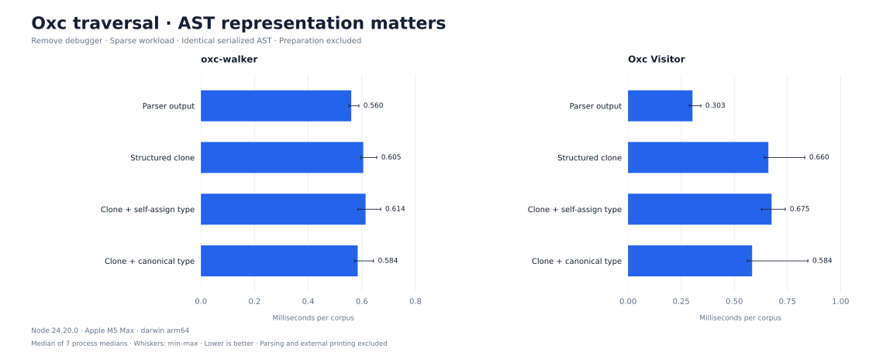

# Why Oxc traversal is fast

**Measured causes: child-field access, callback dispatch, property enumeration, and the editing strategy. AST preparation and canonicalizing `node.type` also matter, with workload-dependent effects.**

Tested `oxc-walker@1.1.1` and `oxc-parser@0.153.0`'s `Visitor` on Node 24.20.0 / Apple M5 Max. Both traversal implementations run in JavaScript. Parsing and printing are outside timing; Rust parser speed is not part of these numbers.

## 1. Costs isolated inside each implementation

Sparse remove-debugger workload, fresh **cloned Acorn AST**, matching the main edit benchmark preparation. Each row changes the stated traversal strategy from the unmodified local clone. Positive means **more time**; brackets show descriptive 95% bootstrap intervals. Percentages are not additive. Times are medians of process medians; effects are geometric means of paired round ratios, so an effect need not equal the ratio of displayed medians.

| Controlled change | Time change |
|---|---:|
| Walker: replace `for…in` with `Object.keys` | +50.5% [+47.7, +53.0] |
| Walker: stop skipping `type/start/end` early | +3.8% [+2.2, +5.0] |
| Walker: create a position context for every node | +1.5% [-0.1, +2.7] |
| Visitor: replace direct child access with key loops | +19.4% [+17.5, +21.0] |
| Visitor: use generic dispatch and a callback on every node | +35.7% [+33.2, +38.1] |

**Visitor:** generated functions read known children (`node.left`, `node.right`) and use numeric slots in a compiled hook table. In the sparse debugger input, the typed plugin invokes 664 parent hooks while the generic control invokes 14,020 node hooks. The key-loop control visits the exact same children in the exact same order. The generic control uses shared named handler slots instead of numeric typed slots and adds a type filter. Its percentage measures this dispatch strategy, not callback-call cost alone. Numeric indexing itself was not separately ablated.

**Walker:** uses a `for…in` loop, skips `type/start/end` before reading their values, rejects non-objects early, and reuses callback context. It still enumerates properties and still maintains editing flags. `for…in` and context reuse are not unique to Oxc: `estree-walker` also uses both. These measurements do not explain every pairwise package gap.

**Context reuse is not established as a major win here.** The per-node position-object control is small and its interval includes zero in the cloned sparse case. Callbacks do not retain the context, so V8 may optimize allocations; this is not an allocation profile. Removing unused edit-flag handling changes time by -5.5% [-8.1, -3.0] on JS i18n and -3.4% [-5.4, -0.8] on original TS/TSX i18n. That control cannot skip, remove, or replace nodes.

## 2. The deletion strategy changes the winner

Visitor has no current-node deletion context. Its plugin scans statement slots when leaving a parent. The normal Walker plugin removes the matched debugger on entry. Giving Walker the same parent-exit helper produces:

| Sparse debugger, cloned AST | ms / corpus |
|---|---:|
| Walker, remove on debugger entry | 0.667 |
| Walker, edit parent slots on exit | 0.978 |
| Visitor, edit parent slots on exit | 0.736 |

With the same parent-exit strategy, switching from Walker to Visitor changes time by -24.7% [-26.2, -23.3]. The original ranking therefore combines traversal cost and plugin strategy. Both implementations produce the same independently checked output.

## 3. Identical AST JSON can have different performance

`structuredClone` preserves AST values but changes their runtime representation. On the public diagnostic fixture, V8 reports `node.type` as `INTERNALIZED_ONE_BYTE_STRING_TYPE` after parsing and `SEQ_ONE_BYTE_STRING_TYPE` after cloning. The control replaces only `type` values with canonical property-name strings before timing. A separate self-assignment control traverses and assigns the same fields without canonicalizing.

| Workload | API | Cloned AST (ms) | Canonical `type` (ms) | Change vs clone |
|---|---|---:|---:|---:|
| debugger-sparse | Walker | 0.605 | 0.584 | -2.6% [-4.0, -0.7] |
| debugger-sparse | Visitor | 0.660 | 0.584 | -8.3% [-12.1, -3.8] |
| styled-sparse | Walker | 1.157 | 1.123 | -1.8% [-4.7, +1.5] |
| styled-sparse | Visitor | 1.186 | 1.434 | +20.9% [+14.2, +28.1] |
| i18n-javascript | Walker | 1.146 | 1.132 | -2.0% [-3.9, -0.1] |
| i18n-javascript | Visitor | 1.359 | 1.359 | -1.9% [-4.8, +0.9] |
| i18n-original | Walker | 1.052 | 1.065 | +1.7% [+0.6, +2.7] |
| i18n-original | Visitor | 1.299 | 0.807 | -39.8% [-41.7, -37.5] |

Every preparation has identical serialized input and verified output. This tests canonicalizing `node.type`, including any resulting changes to V8 field constness and optimization feedback; it does not assign the entire residual parsed-versus-cloned difference to strings. The clone also changes prototypes and property storage. The V8 dump shows some child fields moving from in-object storage to the property array. That layout effect was observed, but its standalone cost was not measured. [V8 property representation](https://v8.dev/blog/fast-properties) explains the storage distinction.

Canonicalization is performed **outside** timing as an attribution control. Its own cost is excluded, so this is not an end-to-end optimization claim or a recommendation to add another AST pass. Results are workload-dependent, including regressions on some Acorn inputs. A parser/decoder should test the representation it actually emits instead of assuming that identical AST JSON implies identical execution cost.

## 4. Metadata explains part of the read-only variation

The original TS/TSX track has 25,310 nodes and no `loc/range`. The pre-transpiled JS track has 19,769 nodes, yet its `range` arrays add 39,538 numeric entries to generic traversal. Comparing those two source tracks alone cannot isolate a cause. Parsing the **same JS** without `loc/range` gives:

| API | Time change without `loc/range` |
|---|---:|
| Walker | -30.8% [-33.1, -28.0] |
| Visitor | -13.7% [-19.2, -7.6] |

Visitor ignores metadata fields already; its smaller change is consistent with layout, allocation/GC pressure, or cache effects even when the visitor never traverses metadata. This experiment does not distinguish those VM effects. Removing metadata also changes object shape, so the measured percentage is not purely a count of avoided property checks.

## Profiles and reproducibility

- [Full measurements and all contrasts](results.md), including self-assignment controls.
- [Experiment scripts and exact changes](../../experiments/oxc-attribution/README.md).
- [Fresh parser results](../../results/oxc-attribution/fresh.json), [cloned AST results](../../results/oxc-attribution/cloned.json), [string controls](../../results/oxc-attribution/strings.json).
- [Traversal coverage](../../results/oxc-attribution/coverage.json), [V8 string dump](../../results/oxc-attribution/v8-strings.txt), [V8 object dump](../../results/oxc-attribution/v8-shapes.txt).

Unprofiled timings: 924 isolated worker processes, 7 rotated/reversed rounds, 20 warmups + 20 samples each; 18,480 measured corpus iterations. Every output is checked outside timing. The Oxc implementations visit the same node identities/occurrence counts; generated field/key-loop order is identical. Unmodified local clones serve as extraction controls; small clone/package differences are included in the full results.

Profiles run separately with reused read-only ASTs, 300 warmup corpora and a nominal 200 µs sampling interval. They locate hot code; their sample shares are not fresh-AST time savings and must not be subtracted between profiles.

| Profile | `walkNode` self samples | `_walk` self samples |
|---|---:|---:|
| [i18n-javascript-visitor-keys-parsed](../../charts/oxc-attribution/i18n-javascript-visitor-keys-parsed-flame.svg) | 68.5% | 0.0% |
| [i18n-javascript-visitor-stock-cloned](../../charts/oxc-attribution/i18n-javascript-visitor-stock-cloned-flame.svg) | 77.5% | 0.0% |
| [i18n-javascript-visitor-stock-interned](../../charts/oxc-attribution/i18n-javascript-visitor-stock-interned-flame.svg) | 79.3% | 0.0% |
| [i18n-javascript-visitor-stock-parsed](../../charts/oxc-attribution/i18n-javascript-visitor-stock-parsed-flame.svg) | 78.7% | 0.0% |
| [i18n-javascript-walker-stock-parsed](../../charts/oxc-attribution/i18n-javascript-walker-stock-parsed-flame.svg) | 0.0% | 90.5% |
| [i18n-original-visitor-stock-interned](../../charts/oxc-attribution/i18n-original-visitor-stock-interned-flame.svg) | 80.9% | 0.0% |
| [i18n-original-visitor-stock-parsed](../../charts/oxc-attribution/i18n-original-visitor-stock-parsed-flame.svg) | 77.7% | 0.0% |
| [i18n-original-walker-stock-parsed](../../charts/oxc-attribution/i18n-original-walker-stock-parsed-flame.svg) | 0.0% | 85.3% |

The main benchmark results and production package sources were not changed. No private business source or dictionary values are included in these artifacts.
