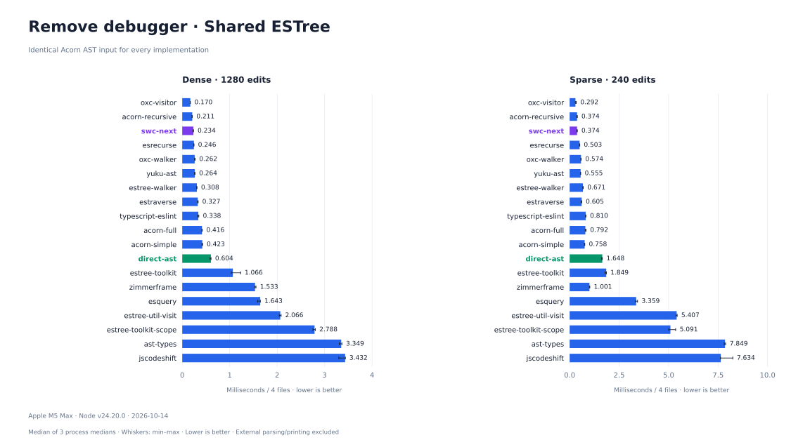
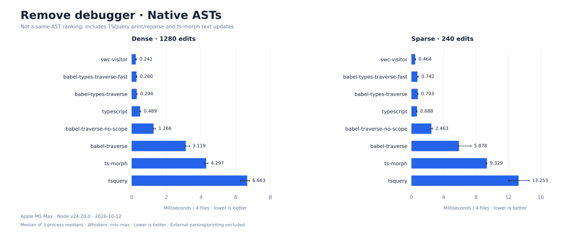

# Remove debugger

[All scenarios](../../README.md) · [Full results and API strategies](../../results/remove-debugger/latest.md) · [Raw measurements](../../results/remove-debugger/latest.json) · [Implementations](../../src/remove-debugger/plugins)

Remove every DebuggerStatement, including consecutive statements and nested functions, methods, switch cases, loops and try/catch/finally. Remove list elements; replace single-statement fields with EmptyStatement. This preserves valid syntax and control flow. Strings and property names containing "debugger" remain unchanged.

```js
// Before
debugger; debugger;
if (flag) debugger;
function f() { debugger; return 1; }

// After
if (flag) ;
function f() { return 1; }
```

## Results

Synthetic JavaScript corpus; four files in each track. Dense has more targets, sparse has more unrelated code. 27 implementations run on the same source. 3 isolated processes per implementation/track, 8 warmups and 20 measured iterations. Small overlapping ranges are not stable rankings.



Native Babel, SWC and TypeScript ASTs are **not ESTree**. Their chart includes AST representation and API costs; it is not a same-AST walker ranking.



## Comparison boundaries

- ESTree participants receive fresh, structurally identical Acorn parser output on every iteration (no AST cloning). Native participants parse the same source into their own ASTs outside measurement.
- Timing includes visitor construction, traversal, queries, scope work when enabled and all edits. Parsing, external printing and validation are excluded. ts-morph internal text synchronization and tsquery.map printing/reparsing stay timed.
- APIs with removal support use native removal/replacement. APIs without removal use explicit statement-slot edits; that work is timed and listed in the strategy table. Acorn is not credited with a remove API. direct-ast recursively inspects properties without visitor keys or a package walker.
- Every measured output is printed and reparsed, then compared structurally with independently authored expected source. Counts and cross-process input/output hashes must agree.
- babel-traverse / babel-traverse-no-scope use @babel/traverse 8; babel-types-traverse-fast uses @babel/types.traverseFast; babel-types-traverse uses @babel/types.traverse. Exact versions are in raw results.
- SWC Next: [439dba8](https://github.com/swc-project/swc-next/commit/439dba831c8f3dd5336013116043b225b27951af). One pinned implementation; no before/after variants.

## Reproduce

```sh
npm ci
npm test
npm run bench -- remove-debugger
PYTHON=.cache/charts-venv/bin/python npm run report
```

Use `--quick` for smoke checks; these write quick.json and never overwrite published results. Charts use recorded data only. Measured 2026-10-12 on Apple M5 Max, darwin/arm64, Node v24.20.0.
