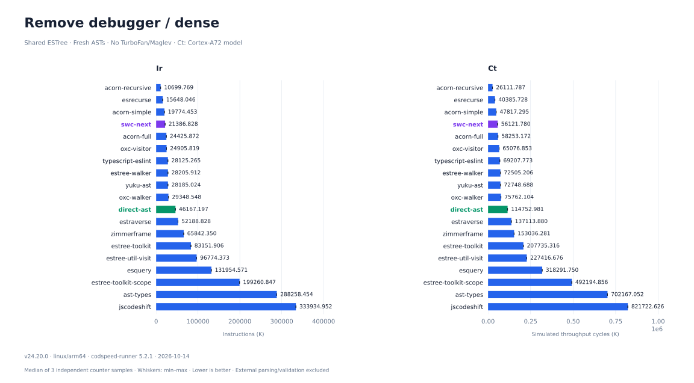
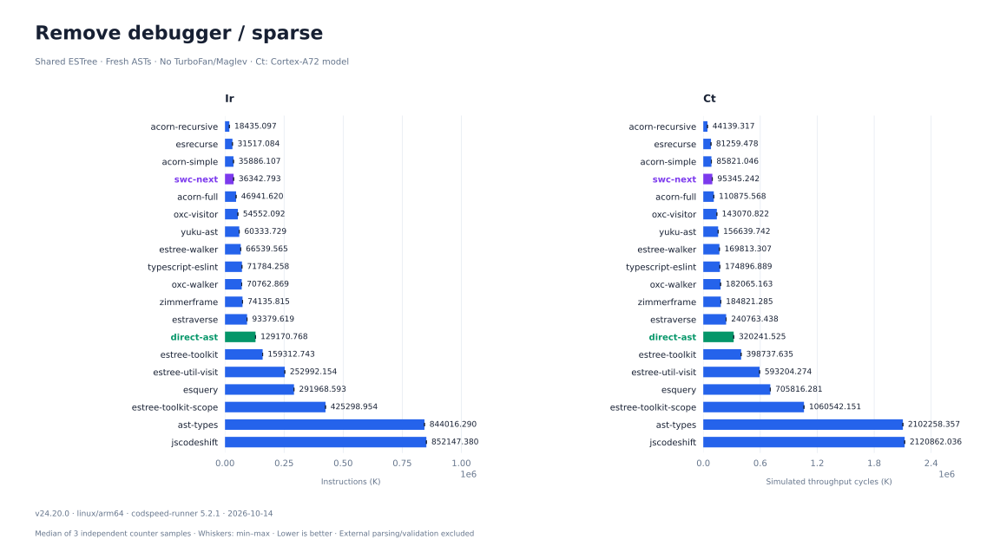
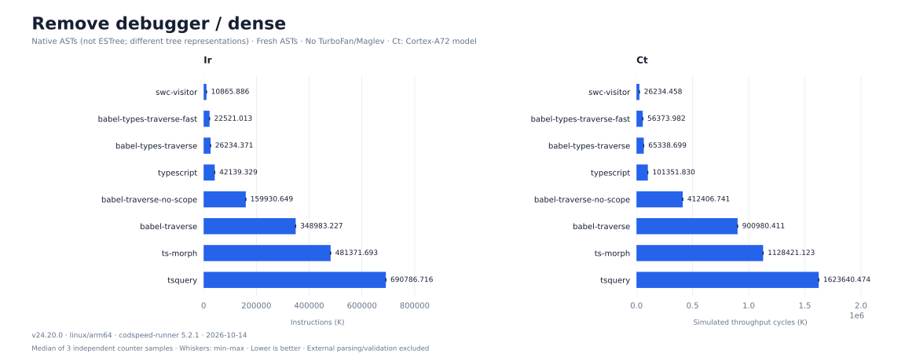
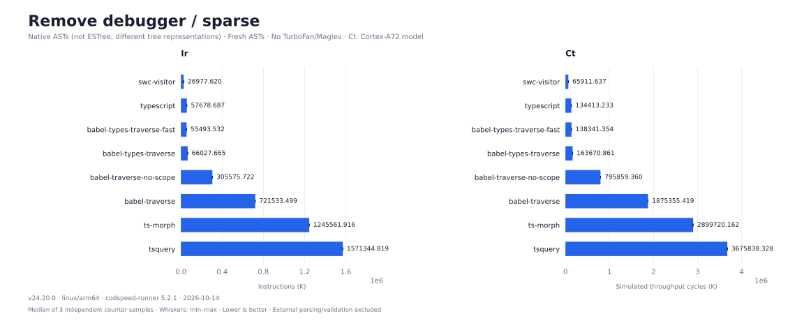

# Remove debugger

[All scenarios](../../README.md) · [Historical wall time and API strategies](../../results/remove-debugger/latest.md) · [Historical wall samples](../../results/remove-debugger/latest.json) · [Implementations](../../src/remove-debugger/plugins)

Remove every DebuggerStatement, including consecutive statements and nested functions, methods, switch cases, loops and try/catch/finally. Remove list elements; replace single-statement fields with EmptyStatement. This preserves valid syntax and control flow. Strings and property names containing "debugger" remain unchanged.

```js
// Before
debugger; debugger;
if (flag) debugger;
function f() { debugger; return 1; }

// After
if (flag) ;
function f() { return 1; }
```

## Results

[Ir/Ct numbers and paired wall time](../cpu/results.md) · [Method and reproduction](../cpu/README.md) · [Comparison with the previous wall-time ranking](../cpu/historical-ranks.md)

Three independent CPU samples per supported combination. Lower Ir (K) and Ct (K) are better. Ct is a model cost, not hardware elapsed cycles; simulation disables optimizing JIT. Each chart has Ir on the left and Ct on the right.





<details>
<summary>Native ASTs — not an ESTree comparison</summary>





</details>

Native Babel, SWC and TypeScript rows include their own AST representation and API costs. Unsupported combinations have no bar. Compare within each input track and AST family.

## Comparison boundaries

- ESTree participants receive fresh, structurally identical Acorn parser output on every iteration (no AST cloning). Native participants parse the same source into their own ASTs outside measurement.
- Measured work includes visitor construction, traversal, queries, scope work when enabled and all edits. Parsing, external printing and validation are excluded. ts-morph internal text synchronization and tsquery.map printing/reparsing stay timed.
- APIs with removal support use native removal/replacement. APIs without removal use explicit statement-slot edits; that work is timed and listed in the strategy table. Acorn is not credited with a remove API. direct-ast recursively inspects properties without visitor keys or a package walker.
- Every measured output is printed and reparsed, then compared structurally with independently authored expected source. Counts and cross-process input/output hashes must agree.
- babel-traverse / babel-traverse-no-scope use @babel/traverse 8; babel-types-traverse-fast uses @babel/types.traverseFast; babel-types-traverse uses @babel/types.traverse. Exact versions are in raw results.
- SWC Next: [a4c4343](https://github.com/swc-project/swc-next/commit/a4c4343d5ed4863884521ed96209d5e56dfd56df). One pinned implementation; no before/after variants.

## CPU reproduction

See [CPU setup](../cpu/README.md) for Linux, pinned tools and the private corpus. To check this scenario without overwriting the full published result:

```sh
npm run bench:cpu -- --match=remove-debugger/ --work=.cache/cpu-remove-debugger --output=results/tmp/cpu-remove-debugger.json
```

The commands below reproduce the **historical wall-time runner**. Its results and environment are kept for comparison.

## Reproduce

```sh
npm ci
npm test
npm run bench -- remove-debugger
PYTHON=.cache/charts-venv/bin/python node scripts/render-wall.mjs
```

Use `--quick` for smoke checks; these write quick.json and never overwrite published results. Charts use recorded data only. Historical wall time measured 2026-10-12 on Apple M5 Max, darwin/arm64, Node v24.20.0.
