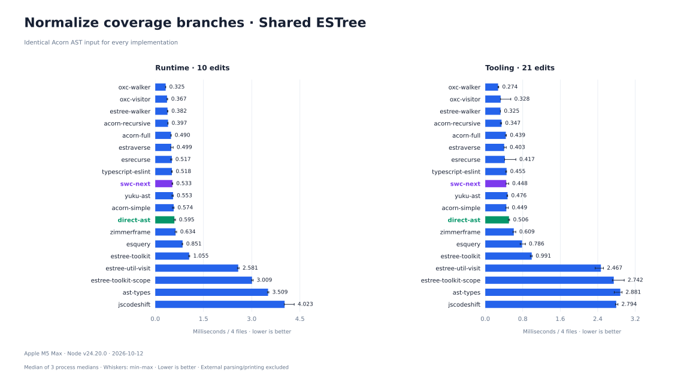
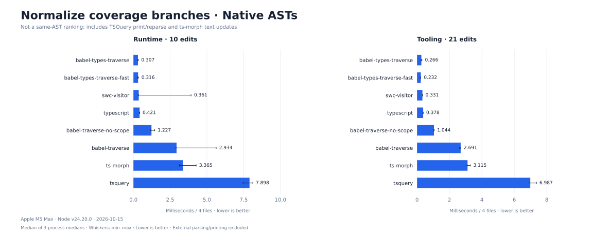

# Normalize coverage branches

[All scenarios](../../README.md) · [Historical wall results](../../results/rstest-coverage/latest.md) · [Historical raw samples](../../results/rstest-coverage/latest.json) · [Corpus and provenance](../../vendor/rstest-coverage/corpus.json)

**A focused real-world AST editing task from Rstest's V8 coverage converter.** Wrap non-block if/else arms, respect the selected phase's ignore rules, and record branch ranges. This is not instrumentation, a complete coverage converter, or a captured production coverage trace.

```js
// Input
if (ready) run(); else stop();

// Normalized AST, shown as code for illustration
if (ready) { run(); } else { stop(); }
```

The production converter only consumes this tree as analysis data; it does not execute regenerated code. Printing in this benchmark is an untimed correctness check.

## Results



Native Babel, SWC and TypeScript trees are **not ESTree** and do not constitute a same-AST ranking.



## Source and corpus

- Business source: [Rstest PR #1734](https://github.com/web-infra-dev/rstest/pull/1734), pinned to [`f3b95e42`](https://github.com/web-infra-dev/rstest/commit/f3b95e42e32c51f77545a86937b5218f92d69d7e), `packages/coverage-v8/src/v8AstConverter.ts`. The [upstream source](../../vendor/rstest-coverage/upstream.ts) and [MIT license](../../vendor/rstest-coverage/LICENSE) are preserved.
- **Runtime:** runInPool, loadEsModule, worker entry, worker setup. Four modules, 101 if statements, **10 natural branch edits**.
- **Tooling:** coverage thresholds, error utilities, pool coordination, VS Code test discovery. Four modules, 84 if statements, **21 natural branch edits**.
- Modules are read from the pinned Git object and transpiled once with the locked `@swc/core` to ES2022 JavaScript. No execution, bundling, minification, target injection or source duplication. Preparation records original and generated hashes plus compiler options; the committed corpus runs without the Rstest checkout.
- Both groups are real source cohorts, not synthetic dense/sparse tracks. They are representative module inputs, not measured frequencies from a production coverage run.

## Measured contract

1. Inspect every applicable IfStatement in source order. Wrap each non-block consequent or alternate in a BlockStatement, preserving the original arm's offsets; leave existing blocks unchanged. An absent else remains absent.
2. Apply ignore-file and hints directly attached to IfStatements: ignore-next excludes that if subtree, ignore-if/else excludes analysis and nested edits in that arm. The outer arm is still wrapped, matching the selected upstream phase. This does **not** implement the full converter's handling of hints attached to other node kinds or ignore-start/stop line regions.
3. Emit ordered descriptors containing the if span and explicit/implicit branch ranges. Explicit branches retain the upstream `start + 1` / `end - 1` convention; this intentionally preserves its empty-statement edge behavior rather than claiming to fix it.
4. Return the edited AST and edit count. Validation checks every descriptor and the entire normalized tree through printing/reparsing, outside timing. Positions inside the descriptors remain offsets in the original source, not the printed result.

The full converter's statement/function maps, source-map lookup, V8 range normalization and execution-count assignment, continuation-offset logic, cache, I/O and report generation are excluded. The timed output is a branch descriptor slice, **not complete Istanbul coverage data**. This workload complements i18n's read-only collection with structural replacement and nested ignore state.

## API fairness

Fresh parser output replaces the cloned-AST preparation used through [8143bc9](https://github.com/SoonIter/visitor-benchmark/tree/8143bc994901c2321b31ad271c83bbcb6e5cf4ca). Changes from that historical run are not implementation speedups.

All **27 adapters** participate: 19 use fresh output from the same Acorn parser on every iteration, without AST cloning; 8 use their own Babel/SWC/TypeScript representations. Parsing, AST preparation and validation are outside the timer. Business state, traversal setup, metadata construction, ordering, edits, scope analysis where enabled, and internal API work are timed.

- Editors use context/path replacement, immutable returns or official compiler factories. Node-only APIs use manual assignment. direct-ast is the explicit manual-recursion baseline.
- Post-order Acorn APIs collect targets before source-order planning; query APIs pay their query/setup costs. They do not claim to prune subtrees when their APIs cannot do so. jscodeshift applies planned child edits before parent wrapping to preserve path validity.
- Zimmerframe returns immutable replacements and carries transformed children into updated parents. Tests verify the original input is unchanged.
- ast-types and jscodeshift register Acorn's PropertyDefinition through the public schema extension API at module initialization. The common input AST is not rewritten. Their added default fields are normalized only by the untimed print/reparse check.
- TSQuery uses `map()`, whose internal printing/reparsing remains timed. Its callback uses the TypeScript transformer API on selected subtrees because returning a replacement from map stops its normal descent. ts-morph uses its official bulk transform and includes internal text synchronization.
- SWC keeps its native AST. A UTF-8-byte-to-UTF-16 table is prepared with the AST; timed descriptor extraction reads that table. Other native adapters also preserve original source offsets in descriptors.

## CPU reproduction

See [CPU setup](../cpu/README.md) for Linux, pinned tools and the private corpus. To check this scenario without overwriting the full published result:

```sh
npm run bench:cpu -- --match=rstest-coverage/ --work=.cache/cpu-rstest-coverage --output=results/tmp/cpu-rstest-coverage.json
```

The commands below reproduce the **historical wall-time runner**. Its results and environment are kept for comparison.

## Verification and reproduction

The reference oracle is independently written in the original mutable style; it shares no editing helper with contestants. Hand-authored expectations additionally check exact ranges and edit counts. Regression inputs cover nested if/else, existing blocks, empty arms, absent else, all selected ignore hints, Unicode offsets, unchanged files and immutable updates. These small regression fixtures do not inflate the measured corpus.

```sh
npm ci
npm test
npm run bench -- rstest-coverage
PYTHON=.cache/charts-venv/bin/python node scripts/render-wall.mjs

# Explicitly recapture the pinned public source (requires its Git object):
RSTEST_ROOT=/path/to/rstest node scripts/rstest-coverage/prepare.mjs
```

Three isolated processes per adapter/cohort, eight warmups, twenty measured iterations, sequential execution with rotated order. Results retain every sample and source hash. Compare within each AST track; this is application-task time, not a universal walker ceiling.

The [raw results](../../results/rstest-coverage/latest.json) record the measured source commit, file hashes and `fresh-parse-v1` preparation method. Historical cloned-AST runs remain available in Git history.
