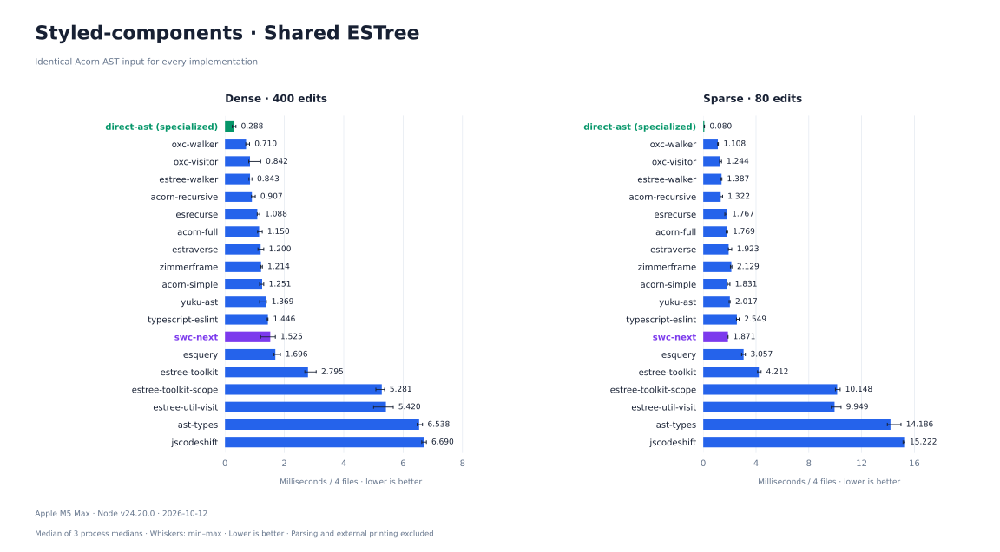
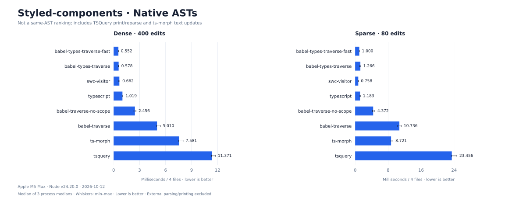

# Styled-components

[All scenarios](../../README.md) · [Full results and API strategies](../../results/styled-components/latest.md) · [Raw measurements](../../results/styled-components/latest.json) · [Implementations](../../src/styled-components/plugins)

Inject displayName and componentId into eligible styled-components declarations. This is a scoped config-injection workload, not the complete upstream plugin. All target declarations are top-level; direct-ast intentionally exploits this and skips unrelated subtrees.

```js
const Card = styled.div`color: red;`;
// becomes
const Card = styled.div.withConfig({
  displayName: "Widget0__Card", componentId: "sc-...-0"
})`color: red;`;
```

## Results

Synthetic JavaScript corpus; four files in each track. Dense has more targets, sparse has more unrelated code. 27 implementations run on the same source. 3 isolated processes per implementation/track, 8 warmups and 20 measured iterations. Small overlapping ranges are not stable rankings.



Native Babel, SWC and TypeScript ASTs are **not ESTree**. Their chart includes AST representation and API costs; it is not a same-AST walker ranking.



## Comparison boundaries

- ESTree participants receive fresh, structurally identical Acorn parser output on every iteration (no AST cloning). Native participants parse the same source into their own ASTs outside measurement.
- Timing includes visitor construction, traversal, queries, scope work when enabled and all edits. Parsing, external printing and validation are excluded. ts-morph internal text synchronization and tsquery.map printing/reparsing stay timed.
- The direct-ast baseline is specialized to this corpus. Other implementations use their package traversal; not all perform identical work, such as scope analysis or wrapper bookkeeping.
- Every measured output is printed and reparsed, then compared structurally with independently authored expected source. Counts and cross-process input/output hashes must agree.
- babel-traverse / babel-traverse-no-scope use @babel/traverse 8; babel-types-traverse-fast uses @babel/types.traverseFast; babel-types-traverse uses @babel/types.traverse. Exact versions are in raw results.
- SWC Next: `da1432e` ([vendored source](../../vendor/swc-next)). One pinned implementation; no before/after variants.

## Reproduce

```sh
npm ci
npm test
npm run bench -- styled-components
PYTHON=.cache/charts-venv/bin/python npm run report
```

Use `--quick` for smoke checks; these write quick.json and never overwrite published results. Charts use recorded data only. Measured 2026-10-15 on Apple M5 Max, darwin/arm64, Node v24.20.0.
